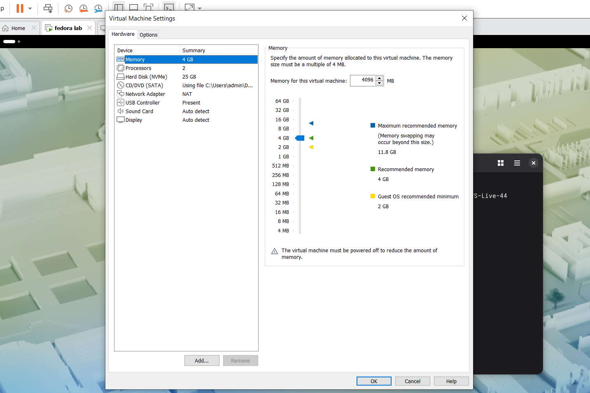
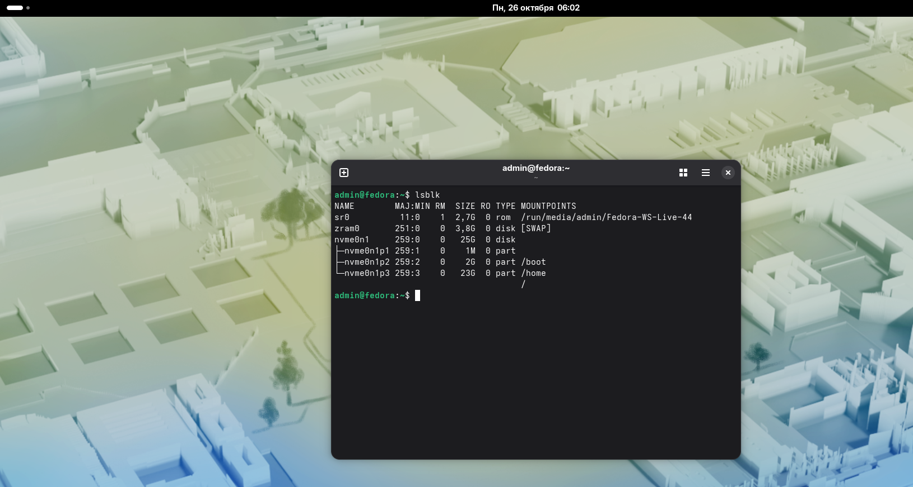

# 01. Установка операционной системы

#  Параметры виртуальной машины
При создании машины я указал следующие настройки:
- Имя: fedora lab
- ОЗУ: 4096 МБ
- Процессоры: 2 ядра
- Жёсткий диск: 40 ГБ
- Сеть: NAT

# Разметка диска
При установке я выбрал ручной режим разметки (Custom). Сделал два раздела:
- **`/`** (корневой) — файловая система `ext4`, занял всё оставшееся место.
- **`swap`** (подкачка) — размер `2048 МБ`.

*Примечание:* Скриншоты самого процесса создания разделов в установщике я сделать забыл короче, но структура разделов видна на скриншоте выше (сделан через терминал уже в установленной системе).

 # Пользователь и система
- Имя пользователя: `admin`
- Имя компьютера: `fedora`
- При создании пользователя я поставил галочку администратора, поэтому могу использовать `sudo`.

**Ответ на вопрос:** *Что произойдёт с данными на диске при выборе автоматической разметки?*
Если выбрать автоматическую разметку, установщик просто сотрет весь диск и создаст свои разделы. Все данные, которые там были, удалятся безвозвратно.
