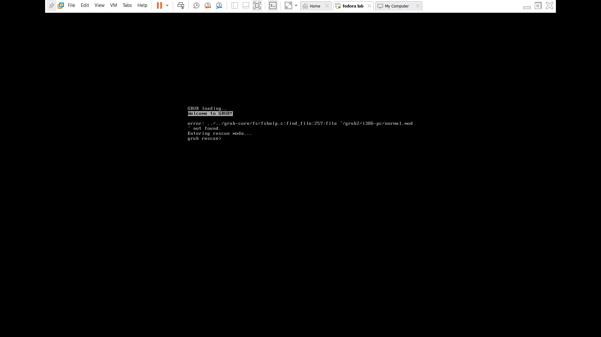
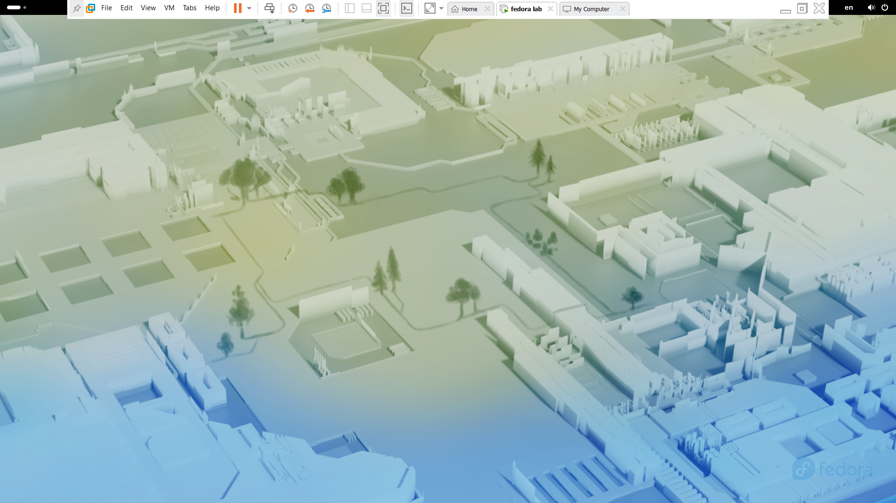

# 04. Выводы и проверка снимков

## Проверка отката системы
Короче, по заданию надо было проверить, как работают снимки. Я решил просто в хлам сломать систему. Ввёл в терминале `sudo rm -rf /boot/*`, чтобы снести загрузчик, и ребутнул (`sudo reboot`).

В итоге при перезагрузке вылез черный экран с ошибкой `grub rescue>`. Система, естественно, не стартанула.

Чтобы всё это наладить, я вырубил виртуалку. В VMware зашёл в Snapshot Manager, выбрал свой сейв `@2-chistaya-sistema` и нажал Restore. Откат занял чуть времени, и машина загрузилась как миленькая.

**Вывод:** Снимки — это оч важная и полезная темка. Если чет наморосил, можно за минуту откатиться и не переустанавливать всё с нуля.
